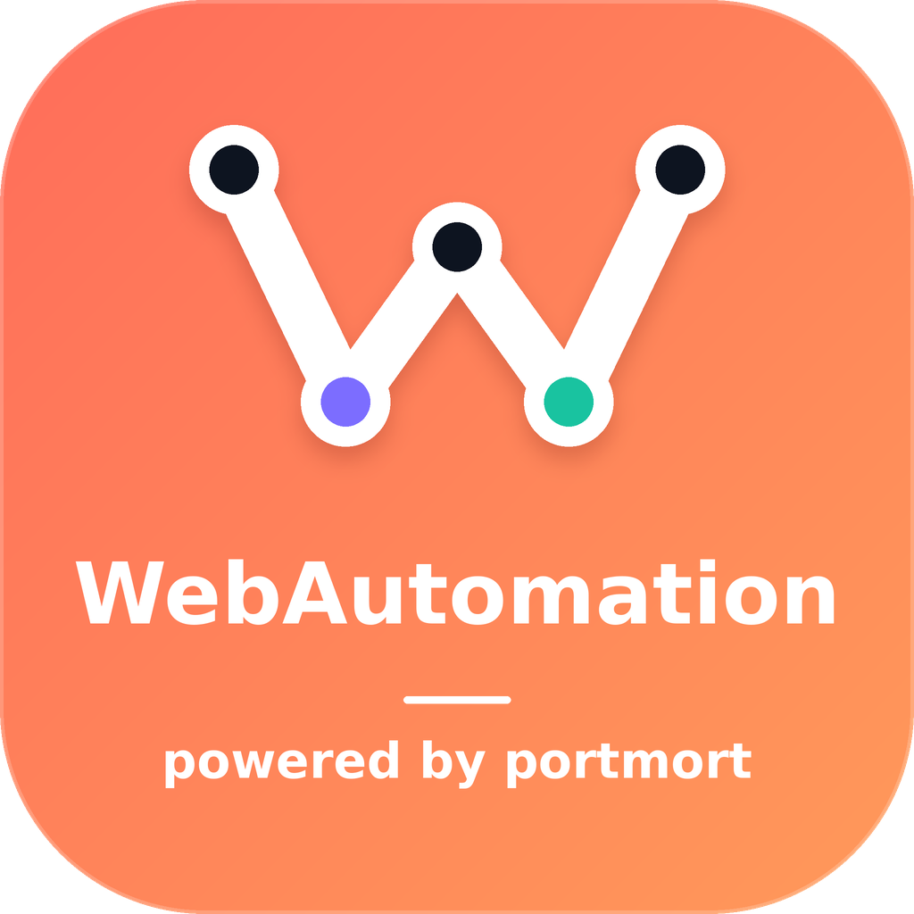

<div align="center">



# webautomation

### مرورگر خودکار، با دکمه‌ی «ضبط» و اتصال مستقیم به n8n

**powered by portmort** · Electron · Playwright · Chromium

[شروع سریع](#-شروع-سریع) · [قابلیت‌ها](#-چرا-flowweb) · [سناریو](#-سناریو-چطور-کار-می‌کند) · [API](#-api-برای-n8n-و-دیگر-ابزارها) · [حمایت از پروژه](#-حمایت-از-پروژه)

</div>

---

## ✨ WebAutomation چیست؟

کارهای تکراری داخل مرورگر را یک بار یاد بگیرید و هر وقت لازم شد اجرا کنید. WebAutomation صفحه‌ها را باز می‌کند، فرم پر می‌کند، دکمه می‌زند، داده می‌خواند، اسکرین‌شات می‌گیرد و نتیجه را برمی‌گرداند. همین کار را هم از رابط گرافیکی انجام می‌دهید و هم از n8n یا هر ابزار دیگری که بتواند HTTP بفرستد.

> کاری که امروز ۲۰ دقیقه دستی انجام می‌دهید، با یک کلیک یا یک فراخوانی API در چند ثانیه انجام می‌شود.

## 🚀 ویژگی‌ها

- 🎬 **ضبط بدون کد**: مرورگر ضبط را باز کنید، کارها را انجام دهید و سناریو ساخته می‌شود.
- 🧩 **ویرایشگر کد و قالب آماده**: سناریو را با کد بنویسید یا از قالب‌های آماده شروع کنید.
- 🔌 **اتصال به n8n**: با HTTP API یک Workflow بسازید که سناریوها را اجرا کند و نتیجه را بگیرد.
- 🗂️ **پروفایل‌های نشست**: یک بار وارد سایت شوید و نشست را ذخیره کنید؛ دفعه‌های بعد بدون ورود دوباره اجرا می‌شود.
- 📸 **اسکرین‌شات و خطایاب**: اگر اجرا خطا بدهد، `failure.png` ذخیره می‌شود.
- 📜 **تاریخچه‌ی کامل**: وضعیت، خروجی، خطا، لاگ و تصویرهای هر اجرا همیشه در دسترس است.
- 🗄️ **همگام‌سازی با دیتابیس** (اختیاری): PostgreSQL، MySQL یا SQL Server. اگر دیتابیس قطع شود، برنامه با داده‌ی محلی کار می‌کند.
- 🌙 **تم تیره و روشن**، رابط واکنش‌گرا و اجرا در پس‌زمینه از کنار ساعت (System Tray).
- 🔒 **امنیت پیش‌فرض**: API فقط روی `127.0.0.1` باز است، با توکن ۳۲ بایتی محافظت می‌شود، و رمزها داخل `safeStorage` ذخیره می‌شوند.

## ⚡ شروع سریع

**پیش‌نیاز:** Node.js نسخه‌ی ۲۰ یا بالاتر.

> نصب‌کننده‌ی برنامه شامل مرورگر Chromium است و نصب آن به اینترنت نیاز ندارد. ساخت نصب‌کننده (`npm run dist:win`) فقط یک بار به اینترنت نیاز دارد تا مرورگر را دانلود و داخل نصب‌کننده قرار دهد.

```bash
npm install
npx playwright install chromium
npm run dev
```

پنجره‌ی webautomation باز می‌شود.

> ⚠️ از `npm ci` استفاده نکنید؛ `npm install` را بزنید.

## 📦 ساخت فایل نصبی

| سیستم‌عامل | دستور | خروجی |
| --- | --- | --- |
| 🪟 ویندوز | `npm run dist:win` | نصب‌کننده‌ی NSIS (`.exe`) |
| 🐧 لینوکس | `npm run dist:linux` | `AppImage` و `.deb` |
| 🍎 مک | `npm run dist:mac` (روی macOS) یا workflow گیت‌هاب | فایل `.dmg` |
| همه‌ی ویندوز و لینوکس | `npm run dist` | همه‌ی خروجی‌های بالا |

خروجی‌ها در پوشه‌ی `release` ساخته می‌شوند.

**مک:** فایل DMG فقط روی macOS ساخته می‌شود. اگر روی ویندوز هستید، کد را در گیت‌هاب بگذارید و workflow به نام `build-mac` را از تب Actions اجرا کنید؛ فایل DMG در بخش Artifacts آماده دانلود است.

> توزیع عمومی روی مک و ویندوز بهتر است با گواهی امضای کد انجام شود. بدون آن ممکن است سیستم هشدار بدهد.

## 🧪 تست

```bash
npm run build
npm test
```

`npm test` ابتدا build می‌گیرد و سپس API، موتور اجرا و رابط Electron را با پروفایل‌های جدا آزمایش می‌کند. تست‌ها Docker را اجرا نمی‌کنند.

## 🧠 سناریو چطور کار می‌کند؟

سناریو یک تابع async است. این متغیرها از قبل آماده‌اند:

| متغیر | کاربرد |
| --- | --- |
| `page`، `context`، `browser` | صفحه و نشست مستقل Chromium برای هر اجرا |
| `input` | داده‌ی ورودی JSON، مثلاً شماره سفارش |
| `secrets` | رمزهایی که در برنامه ذخیره کرده‌اید |
| `playwright` | کتابخانه‌ی Playwright |

نمونه‌ی کوچک:

```javascript
await page.goto('https://example.com');
const title = await page.title();
await page.screenshot({ path: 'shot-title.png' });
return { title, received: input };
```

خروجی `return` به‌صورت ساخت‌یافته برگردانده می‌شود و به n8n یا هر سیستم دیگری قابل استفاده است.

## 🔗 API برای n8n و دیگر ابزارها

webautomation یک API محلی دارد، پیش‌فرض `http://localhost:3434`. نمونه‌ی ساده:

```bash
curl -X POST http://localhost:3434/api/scenarios/SCENARIO_ID/run \
  -H "Authorization: Bearer YOUR_TOKEN" \
  -H "Content-Type: application/json" \
  -d '{"input":{"orderId":"ORD-123"}}'
```

| کار | مسیر |
| --- | --- |
| فهرست سناریوها | `GET /api/scenarios` |
| اجرای سناریو | `POST /api/scenarios/:id/run` |
| وضعیت و خروجی | `GET /api/runs/:runId` |
| لغو اجرا | `POST /api/runs/:runId/cancel` |
| تصاویر اجرا | `GET /api/runs/:runId/artifacts` |

توکن را در تنظیمات برنامه پیدا کنید. مستندات کامل API در بخش‌های بعدی این فایل و در تب «راهنمای API» داخل برنامه آمده است.

## 🐳 n8n با Docker Compose

```bash
cp .env.example .env
docker compose up -d
```

n8n روی `http://localhost:5678` بالا می‌آید. برای دیتابیس‌ها هم پروفایل‌های آماده وجود دارد:

```bash
docker compose --profile postgres up -d    # یا mysql / mssql
```

Electron روی میزبان اجرا می‌شود، چون لاگین و ضبط به پنجره‌ی مرورگر نیاز دارند.

## 🗺️ نقشه‌ی راه

- کنترل اپلیکیشن‌ها و دسکتاپ
- مهاجرت خودکار داده‌ها به مسیر جدید
- امضای کد برای ویندوز و مک

## 👨‍💻 توسعه‌دهنده

ساخته‌شده توسط **Rasol Alibakhshi**
GitHub: [github.com/RasolAlibakhshi](https://github.com/RasolAlibakhshi)

## ❤️ حمایت از پروژه

اگر webautomation در کارتان به شما کمک کرد، با یک دونیت به ادامه‌ی توسعه کمک کنید:

### [☕ حمایت مالی از webautomation](https://daramet.com/PortMort)

هر حمایتی انگیزه‌ی ادامه‌ی پروژه است. ممنون که هستید 🙏

---

<div align="center">

**webautomation** · powered by **portmort** · ساخته‌شده با ❤️ برای کسانی که وقتشان ارزش دارد

</div>
